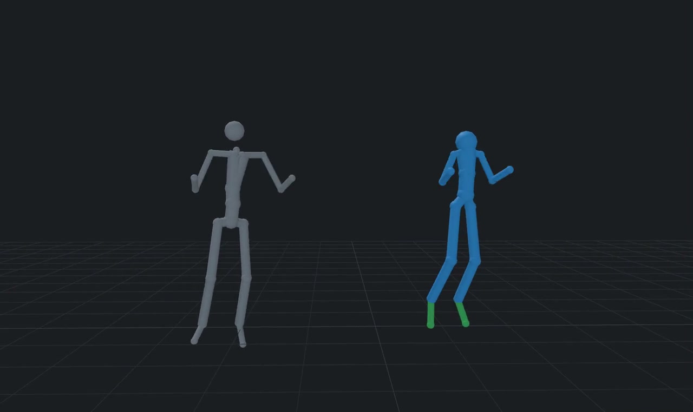
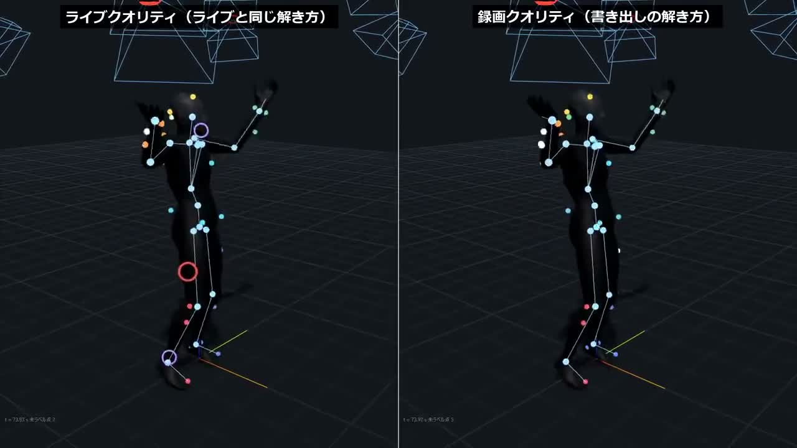

<div align="center">

# MOCAPTYX

### 動きを撮る。モーションをつくる。

自作カメラ × 反射マーカー × 全身モーションキャプチャ

**開発中** · Windowsで検証 · VMD / FBX / BVH · VMC

[モーション配布](#モーション配布) · [できること](#できること) · [必要なもの](#必要なもの) · [公開予定](#公開予定) · [利用方針](#利用方針)

</div>

---

**MOCAPTYXは、自作カメラと反射マーカーを使って全身の動きを収録し、アバターやモーション制作へつなげるプロジェクトです。**

自分のダンスや演技を撮り、キャラクターに合わせ、モーションとして書き出す。作品づくりやモーション配布に使える環境を目指して開発しています。

> [!NOTE]
> **いま公開しているもの：プロジェクト紹介・実演映像・配布モーション・開発状況・公開予定・利用条件の方針。**
> アプリ本体のソース・配布ビルド、自作カメラの設計データ、手指オプションは公開準備中です。
> 完成版のダウンロードやカメラキットの販売は、まだ始まっていません。

## 動きを見る

### 録画した動きを、モデルの体型へ

[](https://junonnwork.github.io/mocaptyx/#retarget)

**[リターゲットの動画を見る・約20秒](https://junonnwork.github.io/mocaptyx/#retarget)** · [MP4を開く](https://junonnwork.github.io/mocaptyx/assets/retarget-preview.mp4)

左の灰色が元モーション、右の青がキャラクターの体型に合わせた結果です。録画した動きを別の骨格へ移し、脚の長さや腰の高さ、足の接地を補正する様子を、開発版の骨格プレビューで紹介しています。約20秒・音声なし・等速再生です。

ライブのVMC出力にも、読み込んだアバターの体型に合わせる仕組みがあります。詳しくは[自動リターゲットと微調整](#ライブも録画も3dモデルにフィット)へ。

### ライブ品質と録画品質を比べる

[](https://junonnwork.github.io/mocaptyx/#comparison)

**[録画再生・比較動画を見る](https://junonnwork.github.io/mocaptyx/)**

開発版の黒スーツ・骨格・マーカー表示を使った映像です。左はライブと同じ解き方、右は録画を書き出すときの解き方。リアルタイム処理速度の測定映像ではなく、結果の見え方を比較しています。掲載版は音声を除き、尺や余白を編集しています。

動画ファイル：[録画の再生・16秒](docs/assets/capture-playback.mp4) / [ライブ品質・録画品質の比較・約26秒](docs/assets/capture-comparison.mp4)

## モーション配布

**[配布モーションを開く（Google Drive）](https://drive.google.com/drive/folders/1ADxN_OLeBSA81Pd95DQ9nzIN-Sr-NAs0?usp=sharing)**

MOCAPTYXで収録・書き出したモーションを公開しています。VMDと、Unity・Unreal向けのFBX・BVHを収録しています。

開発版で書き出した、特定の体型にリターゲット済みのデータです。使用するモデルに合わせて、骨の対応や足の接地などを確認・調整してください。

## このプロジェクトで目指すこと

- **動きを自分で撮れるように。** 対応するカメラと反射マーカーで、全身の動きを収録します。
- **撮った後も扱いやすく。** 再生、範囲指定、体型調整、リターゲット、書き出しまでを整えます。
- **モーションを作品へ。** VMD・FBX・BVH出力やVMC連携を使い、制作環境へ持ち出します。
- **仕組みを学び、つくれるように。** ソース、カメラ設計、導入資料を、条件を明示したうえで順次公開する予定です。

完成版アプリは**Steamでの頒布を予定**しています。公開後もアップデートを続ける前提です。価格・公開時期は未定です。

## できること

以下は**現在の開発環境で実装・検証している機能**です。このリポジトリにアプリ本体はまだ含まれません。

| 段階 | 開発版の機能 | 制作での使い方 |
|---|---|---|
| 準備 | ワンドによるカメラ校正、床・部屋の正面設定 | 複数カメラが同じ空間を見られるように合わせる |
| 撮影 | 光学式の全身トラッキング、ライブ表示 | 反射マーカーから人体の動きを計算する |
| 収録 | 録画・テイク保存・再生 | 撮った動きを後から確認する |
| 解き直し | 録画データからの再計算 | 必要な録画を改めて処理する |
| 調整 | リターゲット、体型の微調整、プレビュー | キャラクターの体型に合わせる |
| 操作 | 範囲指定、長い処理の中断 | 必要な部分を扱い、別の作業へ移る |
| 出力 | VMD・FBX・BVH | モーションを制作ツールで使う |
| 連携 | VMC出力 | 対応アプリのアバターをリアルタイムに動かす |
| 確認 | シミュレーションデモ | 実機を使わず動作を確認する |

### ライブも録画も、3Dモデルにフィット

**キャラクターの骨格・体型に合わせて、動きを自動リターゲット。** 腰の高さや脚の長さの違いを合わせ、足の接地を補正します。

- **ライブ**：読み込んだアバターに合わせた動きを、VMCで対応アプリへ送信します。
- **録画**：保存したモーションをキャラクターに合わせ、プレビューで確認してVMD・FBX・BVHに書き出します。
- **微調整**：腕やひじの開き、肩・腰の高さ、足の間隔を調整できます。設定はアバターごとに保存します。

対応する人型の骨格が前提です。モデルによっては、骨の対応や体型の微調整が必要です。

### 撮影から出力まで

```text
カメラ・反射マーカーの準備
        ↓
空間のキャリブレーション
        ↓
Tポーズで体型を合わせる → ライブ表示・録画
        ↓
再生・範囲選択 → 必要に応じて録画を解き直す
        ↓
キャラクターへのリターゲット・微調整
        ↓
VMD / FBX / BVHとして書き出す
```

VMCはライブの動きを外部アプリへ送るための別の出力経路です。

### 出力形式

| 形式 | 想定する使い道 | 確認すること |
|---|---|---|
| **VMD** | MMD向けモーション、モーション配布 | モデルごとの骨構造、前後の向き、足先・接地 |
| **FBX** | アニメーション・ゲーム向け制作 | 利用先の骨構造、単位、座標系 |
| **BVH** | モーションデータの受け渡し | リターゲット先の体型、骨の対応 |
| **VMC** | 対応アプリへのリアルタイム送信 | 受信側の設定とアバターの調整 |

開発版にはUnity・Unreal向けの出力設定があります。すべてのモデル・制作ツールで同じ結果になるわけではないため、出力先での確認と調整が必要です。

### ライブ品質と録画の再出力

録画を止めた後の出力と、録画データを解き直した出力は分けて保存する設計です。

- **ライブ品質の出力**：ライブ中に解いた動きを使う。まず動きを確認したいときに。
- **録画の再出力**：保存データから改めて計算する。必要な部分を後から仕上げたいときに。

処理時間は録画の長さ、選んだ出力、モデル、PC構成などで変わります。一定の秒数や精度向上を保証するものではありません。

## 必要なもの

| 項目 | 現時点の前提 |
|---|---|
| PC | 主にWindowsで開発・検証中。公開版の最低・推奨構成は準備中 |
| カメラ | 対応する光学式カメラ構成。設計・部品・接続の情報を公開予定 |
| マーカー | 身体に取り付ける反射マーカーと、適切な配置・装着 |
| 撮影空間 | カメラから身体を観測できる空間と、校正作業 |
| 制作先 | 必要に応じてMMD、アニメーション制作ツール、VMC受信アプリなど |

**任意のUSB Webカメラをつなぐだけで、ここで紹介する光学式の構成になるわけではありません。**
必要な台数、接続方法、配置例、費用の目安は、実機の検証と導入資料が整った段階で案内します。

## 開発状況と、まだ改善していること

収録から出力までの基本の流れを動かしながら、実際の録画で問題を調べ、修正を続けています。

| 改善している部分 | 確認しているケース |
|---|---|
| マーカーの認識・追跡 | 身体の隠れ、余分な反射、マーカーを見失った後の復帰 |
| Tポーズと人体の姿勢 | 認識までの時間、復帰後の腕のねじれ、不自然な姿勢 |
| PC負荷への強さ | 重い処理が重なったときの追跡、応答、録画の安定性 |
| リターゲット | キャラクターとの体型差、膝の曲がり、足先・接地 |
| VMD | 向き、内股、モデルごとの結果の違い |
| 配布・導入 | 別のPCでの起動、依存部品、ライセンス表示、導入手順 |

> [!IMPORTANT]
> 開発版です。精度・速度は、カメラ配置、マーカーの見え方、装着、照明、PC構成などに左右されます。
> 掲載している機能を、すべての環境で検証済みの完成機能として案内するものではありません。

## 公開予定

| 公開するもの | 状態 | 含めたい内容 |
|---|---|---|
| **プロジェクト紹介** | 最初の公開 | このREADME、機能一覧、開発状況、公開予定、利用方針 |
| **アプリのソース** | 公開予定 | 公開対象のコード、ビルド・導入手順、正式な利用条件 |
| **自作カメラ** | 公開予定 | 基板・筐体データ、部品表、組み立て・設定手順 |
| **手指オプション** | 公開予定 | 構成、対応範囲、導入・連携方法 |
| **公式アプリ** | Steam頒布予定 | 導入しやすい配布版。時期・価格・提供内容は未定 |
| **使い方とサンプル** | 順次準備 | 設置・撮影の例、調整方法、利用例、その他オプション |

検証と権利確認を終えたものから、利用条件を添えて公開します。日程・順序・仕様は変更される場合があります。詳しくは[ロードマップ](ROADMAP.md)をご覧ください。

## 利用方針

自分で撮影したモーション・動画の配布や販売、収益化を、MOCAPTYX側で制限しない方針です。ソースの学習・改造や、自分用のカメラ製作もできる形で公開を準備しています。

MOCAPTYX自体の製品化・組み込み、カメラやキットの販売は別途有償ライセンスとなります。ライセンスの買い取りも含め、[メールでお気軽にご相談ください](mailto:junonn.work@gmail.com)。

正式な条件は各公開物に添付します。第三者のモデル・楽曲などには、それぞれの利用条件が適用されます。[利用方針の補足](LICENSING.md)

## よくある質問

<details>
<summary><strong>いま、アプリをダウンロードして使えますか？</strong></summary>

初回公開は紹介資料です。アプリ本体・ソース・製作用データはまだ含まれません。リリース時に導入手順、対応環境、利用条件を案内します。

</details>

<details>
<summary><strong>カメラや手指オプションのデータも公開されますか？</strong></summary>

公開を予定しています。カメラは基板・筐体・部品表・組み立て情報、手指は構成・対応範囲・連携方法などを準備します。公開日や確定仕様はまだありません。

</details>

<details>
<summary><strong>作ったモーションを配布・販売してもいいですか？</strong></summary>

自分で撮影・制作したモーションや動画の配布・販売・収益化を、MOCAPTYX側で制限しない方針です。第三者のモデル・楽曲・撮影対象などに関する権利は別途確認してください。正式な条件はリリース時に明記します。

</details>

<details>
<summary><strong>ソース公開とSteam版は、どう違いますか？</strong></summary>

ソースは学習・検証・改造に使える形での公開、Steamは公式アプリの頒布先として予定しています。具体的な配布内容・価格・サポート範囲は未定です。製品化に制限があるため、ソース公開を「OSS」とは呼びません。

</details>

## 更新・フィードバック

更新した内容は[更新履歴](CHANGELOG.md)に、今後の予定は[ロードマップ](ROADMAP.md)に記載します。

不具合や提案はIssuesへどうぞ。環境、操作手順、期待した動作、実際の動作を添えると調べやすくなります。
個人情報、非公開の録画、パスワード、製品化に関する秘密情報は投稿しないでください。

## English overview

MOCAPTYX is a work-in-progress optical motion capture project using DIY cameras and reflective markers.
It is being developed for capture, recording, retargeting, VMC output, and VMD / FBX / BVH export.

This initial repository contains the project overview, development status, roadmap and licensing direction.
Application source, distributable builds, camera designs and hand/finger option documentation are planned for later publication.
An official Steam release is also planned; dates and pricing have not been announced.

We intend to allow sharing and selling your own captured motions and videos. For selling or embedding MOCAPTYX itself, camera kits, or a license buyout, please contact us about a separate paid license.

This is a source-available direction, not an OSI open-source license. Final terms will accompany each released component.
Business inquiries: [junonn.work@gmail.com](mailto:junonn.work@gmail.com).

---

MOCAPTYX · by junonnwork · 開発中 · 最終更新：2026-10-15
